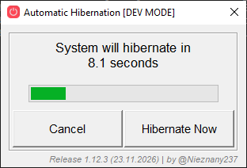

# Automatic Hibernation

A small Windows utility that hibernates your PC after a short countdown. Launch it (from a shortcut, a script, or Task Scheduler), and unless you cancel, the system hibernates when the timer runs out. You can also hibernate immediately.



## Features
- Countdown to hibernation with a progress bar (default: 10 seconds)
- Always-on-top window
- **Hibernate Now** and **Cancel** buttons, plus keyboard shortcuts
- Checks that Windows allows hibernation and exits with an error if it doesn't
- Countdown time can be set via a config file or a command-line argument
- Optional display of tenths of a second

## Requirements
- Windows with hibernation enabled (`powercfg /hibernate on`)
- Python 3.13 or later
- Tkinter
- [hPyT](https://github.com/Zingzy/hPyT)

## Installation
1. Download the source code from the repository.
2. (Optional) Create and activate a virtual environment:
   ```powershell
   python -m venv venv
   .\venv\Scripts\Activate.ps1
   ```
3. Install the required packages:
   ```powershell
   pip install -r requirements.txt
   ```
4. Run the script:
   ```powershell
   python main.py
   ```

## Usage
When the app starts, the countdown begins immediately.

- **Hibernate Now** hibernates right away.
- **Cancel** (or closing the window) stops the countdown and exits without hibernating.

### Keyboard Shortcuts
These are hardcoded for now:

| Shortcut         | Action        |
|------------------|---------------|
| <kbd>Enter</kbd> | Hibernate Now |
| <kbd>Esc</kbd>   | Cancel        |

### Command-line option
Override the countdown time (in seconds) for a single run:

```powershell
python main.py -t 30
```
`/t` and `--time` work too. A value of `0` hibernates almost immediately (0.1 s).

## Configuration
On first launch, a config file is created at:

```
%APPDATA%\Nieznany237\AutoHibernate\config.json
```

| Key                    | Default | Description                                  |
|------------------------|---------|----------------------------------------------|
| `HIBERNATION_TIME`     | `10`    | Countdown length in seconds (positive integer) |
| `TARGET_FPS`           | `25`    | Countdown refresh rate                       |
| `SHOW_DECIMAL_SECONDS` | `false` | Show tenths of a second in the countdown     |

Invalid values fall back to the defaults. The command-line option takes priority over the config file.

## Development
Set the environment variable below to skip the real hibernation call while testing:

```powershell
$env:AUTOHIBERNATE_DEV = "1"
```

## License
This project is licensed under the MIT License.